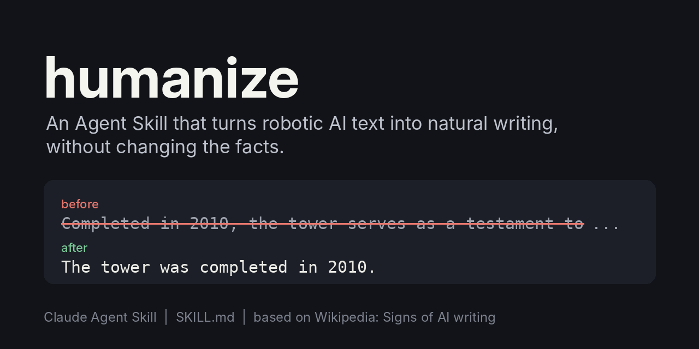

# humanize: AI text humanizer skill for Claude and other AI agents



[](https://github.com/nudarofficial/humanize/actions/workflows/tests.yml)
[](LICENSE)
[](LICENSE)

humanize is an open-source Claude Agent Skill that rewrites robotic, AI-generated writing into natural human writing without changing the facts or the meaning. It follows Wikipedia's [Signs of AI writing](https://en.wikipedia.org/wiki/Wikipedia:Signs_of_AI_writing) guide as it stood in November 2026, works in Claude Code, claude.ai and other agents that read `SKILL.md` files, and comes with a small Python checker that flags AI writing patterns in a draft.

Use it to humanize AI text, clean up drafts that sound like ChatGPT, or check whether a piece of writing reads as AI-generated.

## Contents

- [Example](#example)
- [Features](#features)
- [Install](#install)
- [Usage](#usage)
- [Supported languages](#supported-languages)
- [The pattern checker](#the-pattern-checker)
- [Project structure](#project-structure)
- [Testing](#testing)
- [FAQ](#faq)
- [Sources](#sources)
- [License](#license)

## Example

Input:

> The Burj Khalifa, standing at 828 metres, serves as a testament to Dubai's ambitious vision, symbolizing its rapid transformation. Completed in 2010, it plays a pivotal role in the city's tourism landscape, attracting millions of visitors annually.

Output with the skill:

> The Burj Khalifa is 828 metres tall and was completed in 2010. It is a major part of Dubai's tourism and draws millions of visitors each year.

The height, the year and the visitor claim stay. "Serves as a testament", "symbolizing" and "pivotal role" go, because Wikipedia's editors list them among the most common signs of AI writing. This exact pair is one of the test cases in [`tests/cases.json`](tests/cases.json).

## Features

- There are three modes. Rewrite text you paste, write new text from facts you give, or review a draft and point to the phrases that read as AI-generated.
- Every fact, number, name and claim stays, and the agent is told never to invent sources, quotes or statistics. The tests check this for every example.
- The pattern catalog covers the 2026 additions to Wikipedia's guide: "Y rather than X" framing, corrective disclaimers ("should be treated as..."), vague "associated with" links, the mid-2026 vocabulary (leverage, multifaceted, quietly, steady) and the even 8 to 20 word sentence rhythm.
- It avoids over-correcting. It skips em dashes but keeps varied punctuation, and it leaves alone the things Wikipedia says are not reliable signs, such as good grammar or a mix of formal and casual registers.
- A checker script, `check_patterns.py`, flags AI vocabulary, stock phrases, chatbot leftovers, leaked citation code (`oaicite`, `turn0search0`, `utm_source=chatgpt.com`), formatting habits and placeholder text. It runs locally and needs only Python 3.
- The main `SKILL.md` stays under the spec's recommended 5,000 tokens. The full catalog lives in `references/` and loads only when needed.
- It follows the open [Agent Skills specification](https://agentskills.io/specification) and passes the reference validator, so it works in other agents that support skills.

## Install

Pick the option that matches where you use AI. All of them install the same skill.

### Claude Code (plugin)

```text
/plugin marketplace add nudarofficial/humanize
/plugin install humanize@humanize
```

### Claude Code (manual)

```bash
git clone https://github.com/nudarofficial/humanize.git
mkdir -p ~/.claude/skills
cp -r humanize/skills/humanize ~/.claude/skills/humanize
```

To use it in a single project only, copy the folder to `.claude/skills/humanize` inside that project instead.

### Claude apps (claude.ai, desktop, mobile)

1. Download [`dist/humanize.zip`](dist/humanize.zip). It holds the `humanize` skill folder at its root, which is the layout Claude expects.
2. In Claude, open Customize > Skills, click the + button, choose Create skill, then Upload a skill, and pick the ZIP.
3. Turn the skill on. Skills need code execution enabled; on Team and Enterprise plans an owner may have to allow skills first.

### Other agents (Codex, Cursor, Gemini CLI, GitHub Copilot and more)

With the open skills CLI:

```bash
npx skills add nudarofficial/humanize
```

Or with the GitHub CLI's skill command (in preview):

```bash
gh skill install nudarofficial/humanize humanize
```

You can also copy `skills/humanize` into whatever folder your agent reads skills from.

## Usage

The skill turns on by itself when a request matches it, or you can call it directly with `/humanize` in Claude Code.

Rewrite:

```text
Humanize this LinkedIn post. Keep every number.
<paste text>
```

Write:

```text
Write a short Instagram caption. Photo: Saturn through my 8-inch Dobsonian, 20 November.
```

Review:

```text
Does this cover letter sound AI-generated? Point to the phrases, don't rewrite.
<paste text>
```

To match your own voice, paste two or three paragraphs you wrote yourself and ask the agent to follow them. A writing sample outranks the skill's default voice.

## Supported languages

English gets everything: the full pattern catalog, all three modes and every checker rule.

Arabic and other languages get the language-independent rules: keeping facts, cutting inflated claims and vague attribution, and removing chatbot leftovers, placeholders, decorative formatting and emoji. The checker still catches em dashes, emoji, formatting, chatbot markup and placeholders (and understands Arabic punctuation), but its word lists are English only.

Wikipedia's guide describes English text, and this project doesn't invent equivalent word lists for other languages. The test suite includes Arabic rewrite and review cases.

## The pattern checker

```bash
python3 skills/humanize/scripts/check_patterns.py draft.txt
# or
cat draft.txt | python3 skills/humanize/scripts/check_patterns.py
```

Example output:

```text
L1    [em-dash] Nestled in the heart of Dubai, the tower stands as a testament to ambition ...
L1    [ai-vocab: showcasing] ...
L1    [ai-vocab: testament] ...
L1    [ai-vocab: nestled] ...
L1    [significance] ...
L1    [promotional] ...

6 hits.
```

It exits with code 1 when it finds something, so it also works in scripts and CI. Hits tagged `(review)` are often fine in context (a real list of three things, a literal landscape photo). The checker can't judge meaning, so run it after the rewrite and still reread the text yourself.

## Project structure

```text
humanize/
├── .claude-plugin/
│   ├── marketplace.json      # lets Claude Code install the repo as a plugin
│   └── plugin.json
├── skills/humanize/          # the skill itself
│   ├── SKILL.md              # workflow, modes, output format and rules
│   ├── README.md             # short overview for people browsing the skill
│   ├── examples/
│   │   └── examples.md       # finished rewrites and a review, English and Arabic
│   ├── references/
│   │   └── patterns.md       # full pattern catalog from Wikipedia's guide
│   └── scripts/
│       └── check_patterns.py # pattern checker (Python 3, no dependencies)
├── dist/humanize.zip         # upload package for the Claude apps
├── tests/                    # unit tests, test cases and fixtures
├── tools/build_zip.py        # rebuilds dist/humanize.zip
├── assets/social-preview.png
├── CHANGELOG.md
└── LICENSE
```

## Testing

```bash
python3 -m unittest discover -s tests -v
pip install skills-ref && agentskills validate skills/humanize
```

The tests cover the checker on its own, the frontmatter rules from the Agent Skills spec, and the three modes in English and Arabic across casual, formal, marketing and email styles. For each rewrite they confirm that every listed fact survives, that no number appears unless the input had it, and that the output has no unresolved patterns. GitHub Actions runs the same tests on every push.

The example outputs in `tests/cases.json` were written by following the skill, so they show what a correct result looks like. Running the skill through a model can give different wording each time.

## FAQ

Short answers to the questions people ask most about this skill.

### What is a Claude Agent Skill?

A skill is a folder with a `SKILL.md` file that gives an AI agent instructions for a specific task. The agent reads the short description at startup and loads the full instructions only when a request needs them. Claude Code, the Claude apps and a growing list of other agents support the format.

### How is this different from an AI humanizer website?

Humanizer websites usually paraphrase text with their own model. This skill runs inside the agent you already use, works from a public list of documented AI writing patterns, and treats keeping your facts as a hard rule.

### Will it get text past AI detectors?

That isn't the goal, and the project makes no such promise. Detectors have real error rates and change often. The skill aims at writing that reads better to people. If your school, employer or publisher requires you to disclose AI help, that still applies.

### Does it work for Arabic?

Partly. The fact-keeping and clarity rules apply in any language, and the checker catches language-neutral problems, but the AI vocabulary lists are English. See [Supported languages](#supported-languages).

### Can I add my own rules?

Yes. Add a section at the end of `SKILL.md` with your banned words, tone or house style. Your rules outrank the defaults.

### Does it need internet access or an API key?

No. The skill is plain text plus a Python script with no dependencies.

### How current is the pattern list?

It was built from Wikipedia's guide as read on 22 November 2026, including its Style and Markup subpages. The guide changes as models change, so updates will follow in the changelog.

## Sources

- [Wikipedia: Signs of AI writing](https://en.wikipedia.org/wiki/Wikipedia:Signs_of_AI_writing), its [Style](https://en.wikipedia.org/wiki/Wikipedia:Signs_of_AI_writing/Style) and [Markup](https://en.wikipedia.org/wiki/Wikipedia:Signs_of_AI_writing/Markup) subpages, by Wikipedia contributors and [WikiProject AI Cleanup](https://en.wikipedia.org/wiki/Wikipedia:WikiProject_AI_Cleanup), licensed under CC BY-SA 4.0.
- [Agent Skills specification](https://agentskills.io/specification).

## License

The code (`scripts/`, `tests/`, `tools/`, manifests) is under the MIT License. The skill text, pattern catalog and documentation are under CC BY-SA 4.0, because they adapt CC BY-SA material from Wikipedia. See [LICENSE](LICENSE) for both texts and the attribution.

Claude is a trademark of Anthropic. Wikipedia is a trademark of the Wikimedia Foundation. This project is independent and not affiliated with either.

Copyright © 2026 nudarofficial. Maintained by [nudarofficial](https://github.com/nudarofficial).
